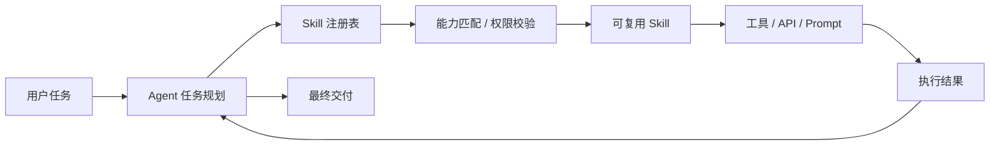
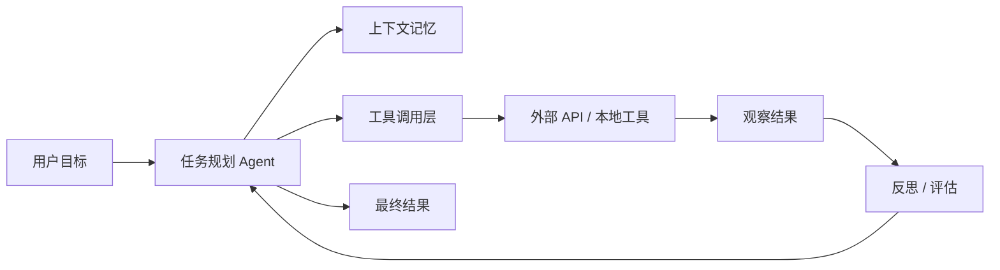
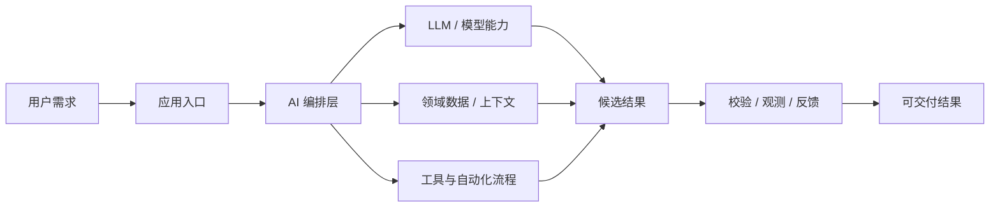

# GitHub AI Daily Trending Top 5

更新时间：2026-11-10T05:46:27Z

筛选范围：仓库名称或描述包含 AI 相关关键词。关键词：ai, agent, agents, agentic, llm, llms, skill, skills, mcp, model context protocol, chatgpt, openai, claude, gemini, copilot, deepseek, rag, embedding, embeddings, transformer, diffusion, machine learning, ml, deep learning, neural, inference, prompt, prompts。

网页版本：由 GitHub Pages 自动发布。

## 1. [anthropics/skills](https://github.com/anthropics/skills)

- 语言：Python
- Stars：191,315
- 主题：agent-skills
- Star 趋势：

- 作用 / 解决的问题：Public repository for Agent Skills
- 适用场景：
  - 适合快速评估 GitHub AI 热榜中新出现或重新升温的技术方向，因为该仓库已获得短期社区关注。
  - 适合多步骤自动化、工具调用和复杂任务编排场景，因为 Agent 模式能把规划、执行、观察和修正串起来。
  - 适合团队沉淀可复用 AI 能力的场景，因为 Skill 把提示词、工具和流程封装成可发现、可组合的单元。
- 架构思想：
  - 它成为热榜的核心原因通常不是单点功能，而是把模型能力、工具、数据和工作流组织成更容易落地的工程结构。
  - 当前 Stars 为 191,315，说明它不只是概念验证，还积累了可观的社区验证和传播势能。
  - 相比只提供单一脚本的仓库，它用 agent-skills 等 topics 明确了能力边界，更容易被目标用户检索和采用。
  - 使用 Python 作为主要实现语言，降低了对应生态开发者集成、扩展和二次开发的成本。
  - 它的稀缺性在于把热门 AI 能力包装成可运行、可组合、可观察的工程入口，而不是停留在论文、提示词或孤立 Demo。
- 原理 / 实现思路：
  - Skills are folders of instructions, scripts, and resources that Claude loads dynamically to improve performance on specialized tasks. Skills teach Claude how to complete specific tasks in a repeatable way, whether that's creating documents with your company's ...
  - This repository contains skills that demonstrate what's possible with Claude's skills system. These skills range from creative applications (art, music, design) to technical tasks (testing web apps, MCP server generation) to enterprise workflows (communication...
  - Each skill is self-contained in its own folder with a SKILL.md file containing the instructions and metadata that Claude uses. Browse through these skills to get inspiration for your own skills or to understand different patterns and approaches.
  - 以上内容由 GitHub 公开 README 自动摘取和归纳，适合作为快速了解入口，深入实现仍以仓库源码和文档为准。

## 2. [meta/astryx](https://github.com/meta/astryx)

- 语言：TypeScript
- Stars：20,712
- 主题：未在 GitHub API 中公开 topics
- Star 趋势：

- 作用 / 解决的问题：An open source design system that's fully customizable and agent ready
- 适用场景：
  - 适合快速评估 GitHub AI 热榜中新出现或重新升温的技术方向，因为该仓库已获得短期社区关注。
  - 适合多步骤自动化、工具调用和复杂任务编排场景，因为 Agent 模式能把规划、执行、观察和修正串起来。
- 架构思想：
  - 它成为热榜的核心原因通常不是单点功能，而是把模型能力、工具、数据和工作流组织成更容易落地的工程结构。
  - 当前 Stars 为 20,712，说明它不只是概念验证，还积累了可观的社区验证和传播势能。
  - 使用 TypeScript 作为主要实现语言，降低了对应生态开发者集成、扩展和二次开发的成本。
  - 它的稀缺性在于把热门 AI 能力包装成可运行、可组合、可观察的工程入口，而不是停留在论文、提示词或孤立 Demo。
- 原理 / 实现思路：
  - An open source design system that's fully customizable and built for how we build now:   by people and the agents working alongside them.
  - Astryx is an open source design system that grew inside Meta over the last eight years, where it became the most-used and largest design system in the company — powering 13,000+ apps and shaped by the engineers, designers, and product teams who depend on it ev...
  - It ships 150+ accessible components, brand-level theming, dark mode, ready-to-ship templates, and a CLI as one cohesive system. You import pre-built CSS and use typed React components — no build plugin, no styling library to adopt — and both people and AI assi...
  - 以上内容由 GitHub 公开 README 自动摘取和归纳，适合作为快速了解入口，深入实现仍以仓库源码和文档为准。

## 3. [anthropics/claude-quickstarts](https://github.com/anthropics/claude-quickstarts)

- 语言：Python
- Stars：20,133
- 主题：未在 GitHub API 中公开 topics
- Star 趋势：

- 作用 / 解决的问题：A collection of projects designed to help developers quickly get started with building deployable applications using the Claude API
- 适用场景：
  - 适合快速评估 GitHub AI 热榜中新出现或重新升温的技术方向，因为该仓库已获得短期社区关注。
  - 适合围绕 未在 GitHub API 中公开 topics 做技术调研、竞品分析或原型验证，因为仓库主题与当前 AI 热点高度相关。
- 架构思想：
  - 它成为热榜的核心原因通常不是单点功能，而是把模型能力、工具、数据和工作流组织成更容易落地的工程结构。
  - 当前 Stars 为 20,133，说明它不只是概念验证，还积累了可观的社区验证和传播势能。
  - 使用 Python 作为主要实现语言，降低了对应生态开发者集成、扩展和二次开发的成本。
  - 它的稀缺性在于把热门 AI 能力包装成可运行、可组合、可观察的工程入口，而不是停留在论文、提示词或孤立 Demo。
- 原理 / 实现思路：
  - Claude Quickstarts is a collection of projects designed to help developers quickly get started with building  applications using the Claude API. Each quickstart provides a foundation that you can easily build upon and customize for your specific needs.
  - A customer support agent powered by Claude. This project demonstrates how to leverage Claude's natural language understanding and generation capabilities to create an AI-assisted customer support system with access to a knowledge base.
  - [Go to Customer Support Agent Quickstart](./customer-support-agent)
  - 以上内容由 GitHub 公开 README 自动摘取和归纳，适合作为快速了解入口，深入实现仍以仓库源码和文档为准。

## 4. [garrytan/gbrain](https://github.com/garrytan/gbrain)

- 语言：TypeScript
- Stars：32,278
- 主题：未在 GitHub API 中公开 topics
- Star 趋势：

- 作用 / 解决的问题：Garry's Opinionated OpenClaw/Hermes Agent Brain
- 适用场景：
  - 适合快速评估 GitHub AI 热榜中新出现或重新升温的技术方向，因为该仓库已获得短期社区关注。
  - 适合多步骤自动化、工具调用和复杂任务编排场景，因为 Agent 模式能把规划、执行、观察和修正串起来。
- 架构思想：
  - 它成为热榜的核心原因通常不是单点功能，而是把模型能力、工具、数据和工作流组织成更容易落地的工程结构。
  - 当前 Stars 为 32,278，说明它不只是概念验证，还积累了可观的社区验证和传播势能。
  - 使用 TypeScript 作为主要实现语言，降低了对应生态开发者集成、扩展和二次开发的成本。
  - 它的稀缺性在于把热门 AI 能力包装成可运行、可组合、可观察的工程入口，而不是停留在论文、提示词或孤立 Demo。
- 原理 / 实现思路：
  - Keep skills beside knowledge. New local brains include memory skills in their
  - real-use verification are separate steps. Staged migration preserves sharing
  - choices and personal edits. See [shared brain skills](docs/guides/shared-brain-skills.md).
  - 以上内容由 GitHub 公开 README 自动摘取和归纳，适合作为快速了解入口，深入实现仍以仓库源码和文档为准。

## 5. [vercel-labs/agent-browser](https://github.com/vercel-labs/agent-browser)

- 语言：Rust
- Stars：48,672
- 主题：未在 GitHub API 中公开 topics
- Star 趋势：

- 作用 / 解决的问题：Browser automation CLI for AI agents
- 适用场景：
  - 适合快速评估 GitHub AI 热榜中新出现或重新升温的技术方向，因为该仓库已获得短期社区关注。
  - 适合多步骤自动化、工具调用和复杂任务编排场景，因为 Agent 模式能把规划、执行、观察和修正串起来。
- 架构思想：
  - 它成为热榜的核心原因通常不是单点功能，而是把模型能力、工具、数据和工作流组织成更容易落地的工程结构。
  - 当前 Stars 为 48,672，说明它不只是概念验证，还积累了可观的社区验证和传播势能。
  - 使用 Rust 作为主要实现语言，降低了对应生态开发者集成、扩展和二次开发的成本。
  - 它的稀缺性在于把热门 AI 能力包装成可运行、可组合、可观察的工程入口，而不是停留在论文、提示词或孤立 Demo。
- 原理 / 实现思路：
  - Browser automation for AI agents: open pages, read them as an accessibility tree, and act on elements from the shell.
  - agent-browser is a native Rust CLI that gives an AI agent a browser it can drive one command at a time. snapshot returns the page as compact text with a ref such as @e1 for each element. The agent acts on a ref, reads the page again to check the result, and re...
  - agent-browser install           # download Chrome for Testing (first time only)
  - 以上内容由 GitHub 公开 README 自动摘取和归纳，适合作为快速了解入口，深入实现仍以仓库源码和文档为准。

