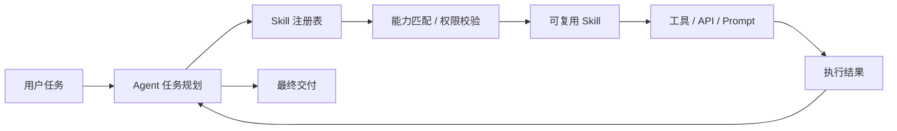
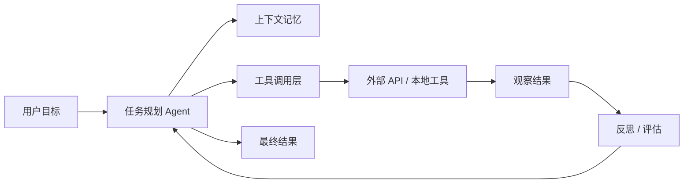
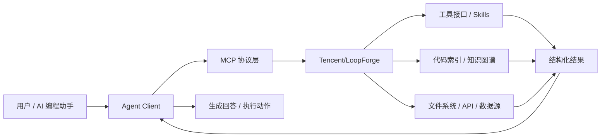

# GitHub AI Daily Trending Top 5

更新时间：2026-11-18T05:43:40Z

筛选范围：仓库名称或描述包含 AI 相关关键词。关键词：ai, agent, agents, agentic, llm, llms, skill, skills, mcp, model context protocol, chatgpt, openai, claude, gemini, copilot, deepseek, rag, embedding, embeddings, transformer, diffusion, machine learning, ml, deep learning, neural, inference, prompt, prompts。

网页版本：由 GitHub Pages 自动发布。

## 1. [elementalsouls/Claude-BugHunter](https://github.com/elementalsouls/Claude-BugHunter)

- 语言：Python
- Stars：9,718
- 主题：ai-security, anthropic, application-security, bug-bounty, bugbounty, bugcrowd, claude, claude-code, claude-skills, ethical-hacking, hackerone, offensive-security, pentesting, red-team, security-tools, web-security
- Star 趋势：

- 作用 / 解决的问题：A Claude Code skill bundle for bug hunting and external red-team work - 82 skills, 15 slash commands, 681 disclosed-report patterns curated across 24 core vulnerability classes, plus enterprise identity + infrastructure attack matrices.
- 适用场景：
  - 适合快速评估 GitHub AI 热榜中新出现或重新升温的技术方向，因为该仓库已获得短期社区关注。
  - 适合团队沉淀可复用 AI 能力的场景，因为 Skill 把提示词、工具和流程封装成可发现、可组合的单元。
- 架构思想：
  - 它成为热榜的核心原因通常不是单点功能，而是把模型能力、工具、数据和工作流组织成更容易落地的工程结构。
  - 当前 Stars 为 9,718，说明它不只是概念验证，还积累了可观的社区验证和传播势能。
  - 相比只提供单一脚本的仓库，它用 ai-security, anthropic, application-security, bug-bounty, bugbounty, bugcrowd, claude, claude-code, claude-skills, ethical-hacking, hackerone, offensive-security, pentesting, red-team, security-tools, web-security 等 topics 明确了能力边界，更容易被目标用户检索和采用。
  - 使用 Python 作为主要实现语言，降低了对应生态开发者集成、扩展和二次开发的成本。
  - 它的稀缺性在于把热门 AI 能力包装成可运行、可组合、可观察的工程入口，而不是停留在论文、提示词或孤立 Demo。
- 原理 / 实现思路：
  - A self-contained Claude skill bundle for bug hunting and external red-team work · 83 skills · 15 slash commands · 681 disclosed-report patterns (433 now individually cited & auditable) across 24 core vulnerability classes · enterprise identity + infrastructure...
  - Think — bb-methodology + redteam-mindset: the 5-phase non-linear workflow, critical-thinking framework, and red-team operator discipline.
  - Hunt webapps — 58 hunt-* skills curated from 681 disclosed HackerOne reports: per-class detection patterns, payloads, bypass tables, and chain templates.
  - 以上内容由 GitHub 公开 README 自动摘取和归纳，适合作为快速了解入口，深入实现仍以仓库源码和文档为准。

## 2. [mvanhorn/last30days-skill](https://github.com/mvanhorn/last30days-skill)

- 语言：Python
- Stars：69,301
- 主题：ai-prompts, ai-skill, bluesky, claude, claude-code, clawhub, deep-research, hackernews, instagram, openclaw, polymarket, recency, reddit, research, social-media, tiktok, trends, twitter, web-search, youtube
- Star 趋势：

- 作用 / 解决的问题：AI agent skill that researches any topic across Reddit, X, YouTube, HN, Polymarket, and the web - then synthesizes a grounded summary
- 适用场景：
  - 适合快速评估 GitHub AI 热榜中新出现或重新升温的技术方向，因为该仓库已获得短期社区关注。
  - 适合多步骤自动化、工具调用和复杂任务编排场景，因为 Agent 模式能把规划、执行、观察和修正串起来。
  - 适合团队沉淀可复用 AI 能力的场景，因为 Skill 把提示词、工具和流程封装成可发现、可组合的单元。
- 架构思想：
  - 它成为热榜的核心原因通常不是单点功能，而是把模型能力、工具、数据和工作流组织成更容易落地的工程结构。
  - 当前 Stars 为 69,301，说明它不只是概念验证，还积累了可观的社区验证和传播势能。
  - 相比只提供单一脚本的仓库，它用 ai-prompts, ai-skill, bluesky, claude, claude-code, clawhub, deep-research, hackernews, instagram, openclaw, polymarket, recency, reddit, research, social-media, tiktok, trends, twitter, web-search, youtube 等 topics 明确了能力边界，更容易被目标用户检索和采用。
  - 使用 Python 作为主要实现语言，降低了对应生态开发者集成、扩展和二次开发的成本。
  - 它的稀缺性在于把热门 AI 能力包装成可运行、可组合、可观察的工程入口，而不是停留在论文、提示词或孤立 Demo。
- 原理 / 实现思路：
  - English \| [Français](README.fr.md) \| [Deutsch](README.de.md) \| [Español](README.es.md) \| [Português (Brasil)](README.pt-BR.md) \| [日本語](README.ja.md) \| [简体中文](README.zh-CN.md) \| [العربية](README.ar.md) \| [فارسی](README.fa.md) \| [Türkçe](README.tr.md)
  - An AI agent-led search engine scored by upvotes, likes, and real money - not editors.
  - This README tracks the current v4 pipeline. The runtime skill spec lives in [skills/last30days/SKILL.md](skills/last30days/SKILL.md), which is the source of truth for the latest command and setup behavior.
  - 以上内容由 GitHub 公开 README 自动摘取和归纳，适合作为快速了解入口，深入实现仍以仓库源码和文档为准。

## 3. [alibaba/open-code-review](https://github.com/alibaba/open-code-review)

- 语言：Go
- Stars：53,891
- 主题：agent, agent-skills, code-review, code-review-assistant, harness, repository-level-context
- Star 趋势：

- 作用 / 解决的问题：Secure, fast, efficient, battle-tested at Alibaba's scale. Hybrid architecture code review tool: deterministic pipelines + LLM Agent, precise line-level comments, built-in multi-language ruleset (NPE, thread-safety, XSS, SQL injection), OpenAI & Anthropic compatible.
- 适用场景：
  - 适合快速评估 GitHub AI 热榜中新出现或重新升温的技术方向，因为该仓库已获得短期社区关注。
  - 适合多步骤自动化、工具调用和复杂任务编排场景，因为 Agent 模式能把规划、执行、观察和修正串起来。
- 架构思想：
  - 它成为热榜的核心原因通常不是单点功能，而是把模型能力、工具、数据和工作流组织成更容易落地的工程结构。
  - 当前 Stars 为 53,891，说明它不只是概念验证，还积累了可观的社区验证和传播势能。
  - 相比只提供单一脚本的仓库，它用 agent, agent-skills, code-review, code-review-assistant, harness, repository-level-context 等 topics 明确了能力边界，更容易被目标用户检索和采用。
  - 使用 Go 作为主要实现语言，降低了对应生态开发者集成、扩展和二次开发的成本。
  - 它的稀缺性在于把热门 AI 能力包装成可运行、可组合、可观察的工程入口，而不是停留在论文、提示词或孤立 Demo。
- 原理 / 实现思路：
  - English \| <a href="docs/i18n/README.zh-CN.md">简体中文</a> \| <a href="docs/i18n/README.ja-JP.md">日本語</a> \| <a href="docs/i18n/README.ko-KR.md">한국어</a> \| <a href="docs/i18n/README.ru-RU.md">Русский</a>
  - Open Code Review is an AI-powered code review CLI tool. It originated as Alibaba Group's internal official AI code review assistant — over the past two years, it has served tens of thousands of developers and identified millions of code defects. After thorough...
  - It reads Git diffs, sends changed files to a configurable LLM via an agent with tool-use capabilities, and generates structured review comments with line-level precision. The agent can read full file contents, search the codebase, inspect other changed files f...
  - 以上内容由 GitHub 公开 README 自动摘取和归纳，适合作为快速了解入口，深入实现仍以仓库源码和文档为准。

## 4. [Tencent/LoopForge](https://github.com/Tencent/LoopForge)

- 语言：Go
- Stars：3,435
- 主题：agent-orchestration, agentic-workflow, ai-agents, ai-coding, claude-code, code-review, codebuddy, codex, coding-agents, cursor, developer-tools, human-on-the-loop, llm, mcp, multi-agent, sdlc, self-hosted, sop, workflow-automation, workflow-engine
- Star 趋势：

- 作用 / 解决的问题：Self-hosted workflows for coding-agent delivery. Orchestrate CodeBuddy, Codex and Claude Code with scripts and human approval gates. Includes Local workflows for coding assistants.
- 适用场景：
  - 适合快速评估 GitHub AI 热榜中新出现或重新升温的技术方向，因为该仓库已获得短期社区关注。
  - 适合需要把外部工具、代码库、数据源接入 AI Agent 的场景，因为 MCP 能把能力封装成标准工具接口。
  - 适合多步骤自动化、工具调用和复杂任务编排场景，因为 Agent 模式能把规划、执行、观察和修正串起来。
- 架构思想：
  - 它成为热榜的核心原因通常不是单点功能，而是把模型能力、工具、数据和工作流组织成更容易落地的工程结构。
  - 当前 Stars 为 3,435，说明它不只是概念验证，还积累了可观的社区验证和传播势能。
  - 相比只提供单一脚本的仓库，它用 agent-orchestration, agentic-workflow, ai-agents, ai-coding, claude-code, code-review, codebuddy, codex, coding-agents, cursor, developer-tools, human-on-the-loop, llm, mcp, multi-agent, sdlc, self-hosted, sop, workflow-automation, workflow-engine 等 topics 明确了能力边界，更容易被目标用户检索和采用。
  - 使用 Go 作为主要实现语言，降低了对应生态开发者集成、扩展和二次开发的成本。
  - 它的稀缺性在于把热门 AI 能力包装成可运行、可组合、可观察的工程入口，而不是停留在论文、提示词或孤立 Demo。
- 原理 / 实现思路：
  - LoopForge is a self-hosted workspace where your team ships software with coding agents. Describe what you need to Main Bot in chat: it opens a Docker sandbox, checks out your repositories, delegates to project roles, and opens the PR. When a way of working pro...
  - Coding-agent CLIs do the work: CodeBuddy, Codex, Claude Code, OpenCode, Cursor CLI, Antigravity, Kimi Code, Pi, DeepSeek Harness and ZCode. LoopForge adds the roles, sandboxes, checkpoints and history around them, all on your own infrastructure under the MIT l...
  - \| Best for \| Exploring, quick fixes, iterating with the agent \| Repeatable delivery with fixed stages and sign-off \|
  - 以上内容由 GitHub 公开 README 自动摘取和归纳，适合作为快速了解入口，深入实现仍以仓库源码和文档为准。

## 5. [dream-num/univer](https://github.com/dream-num/univer)

- 语言：TypeScript
- Stars：29,235
- 主题：board, collaboration, doc, docx, excel, offce365, office, pdf, ppt, pptx, presentation, sdk, sheet, slides, spreadsheet, univer, word, wordprocessor, workspace, xlsx
- Star 趋势：

- 作用 / 解决的问题：Build your own AI office with Univer Office SDK. Bring editing, calculation, collaboration, and file processing into your product for people and AI agents. Built on an extensible open-source core.
- 适用场景：
  - 适合快速评估 GitHub AI 热榜中新出现或重新升温的技术方向，因为该仓库已获得短期社区关注。
  - 适合多步骤自动化、工具调用和复杂任务编排场景，因为 Agent 模式能把规划、执行、观察和修正串起来。
- 架构思想：
  - 它成为热榜的核心原因通常不是单点功能，而是把模型能力、工具、数据和工作流组织成更容易落地的工程结构。
  - 当前 Stars 为 29,235，说明它不只是概念验证，还积累了可观的社区验证和传播势能。
  - 相比只提供单一脚本的仓库，它用 board, collaboration, doc, docx, excel, offce365, office, pdf, ppt, pptx, presentation, sdk, sheet, slides, spreadsheet, univer, word, wordprocessor, workspace, xlsx 等 topics 明确了能力边界，更容易被目标用户检索和采用。
  - 使用 TypeScript 作为主要实现语言，降低了对应生态开发者集成、扩展和二次开发的成本。
  - 它的稀缺性在于把热门 AI 能力包装成可运行、可组合、可观察的工程入口，而不是停留在论文、提示词或孤立 Demo。
- 原理 / 实现思路：
  - [Open-source capabilities](#open-source-capabilities)
  - [🚀 Build on the open-source foundation](#what-you-can-build)
  - [Quick start: an open-source spreadsheet editor](#quick-start)
  - 以上内容由 GitHub 公开 README 自动摘取和归纳，适合作为快速了解入口，深入实现仍以仓库源码和文档为准。

