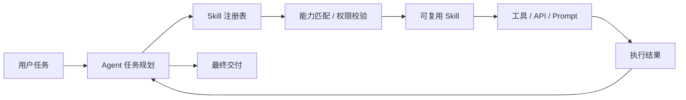
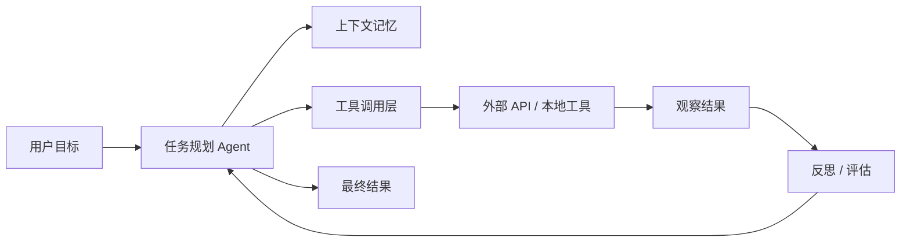
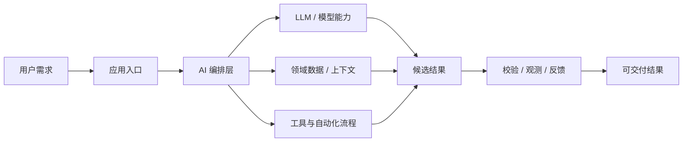

# GitHub AI Daily Trending Top 5

更新时间：2026-11-20T05:30:36Z

筛选范围：仓库名称或描述包含 AI 相关关键词。关键词：ai, agent, agents, agentic, llm, llms, skill, skills, mcp, model context protocol, chatgpt, openai, claude, gemini, copilot, deepseek, rag, embedding, embeddings, transformer, diffusion, machine learning, ml, deep learning, neural, inference, prompt, prompts。

网页版本：由 GitHub Pages 自动发布。

## 1. [elementalsouls/Claude-BugHunter](https://github.com/elementalsouls/Claude-BugHunter)

- 语言：Python
- Stars：12,840
- 主题：ai-security, anthropic, application-security, bug-bounty, bugbounty, bugcrowd, claude, claude-code, claude-skills, ethical-hacking, hackerone, offensive-security, pentesting, red-team, security-tools, web-security
- Star 趋势：

- 作用 / 解决的问题：A Claude Code skill bundle for bug hunting and external red-team work - 82 skills, 15 slash commands, 681 disclosed-report patterns curated across 24 core vulnerability classes, plus enterprise identity + infrastructure attack matrices.
- 适用场景：
  - 适合快速评估 GitHub AI 热榜中新出现或重新升温的技术方向，因为该仓库已获得短期社区关注。
  - 适合团队沉淀可复用 AI 能力的场景，因为 Skill 把提示词、工具和流程封装成可发现、可组合的单元。
- 架构思想：
  - 它成为热榜的核心原因通常不是单点功能，而是把模型能力、工具、数据和工作流组织成更容易落地的工程结构。
  - 当前 Stars 为 12,840，说明它不只是概念验证，还积累了可观的社区验证和传播势能。
  - 相比只提供单一脚本的仓库，它用 ai-security, anthropic, application-security, bug-bounty, bugbounty, bugcrowd, claude, claude-code, claude-skills, ethical-hacking, hackerone, offensive-security, pentesting, red-team, security-tools, web-security 等 topics 明确了能力边界，更容易被目标用户检索和采用。
  - 使用 Python 作为主要实现语言，降低了对应生态开发者集成、扩展和二次开发的成本。
  - 它的稀缺性在于把热门 AI 能力包装成可运行、可组合、可观察的工程入口，而不是停留在论文、提示词或孤立 Demo。
- 原理 / 实现思路：
  - A self-contained Claude skill bundle for bug hunting and external red-team work · 83 skills · 15 slash commands · 681 disclosed-report patterns (433 now individually cited & auditable) across 24 core vulnerability classes · enterprise identity + infrastructure...
  - Think — bb-methodology + redteam-mindset: the 5-phase non-linear workflow, critical-thinking framework, and red-team operator discipline.
  - Hunt webapps — 58 hunt-* skills curated from 681 disclosed HackerOne reports: per-class detection patterns, payloads, bypass tables, and chain templates.
  - 以上内容由 GitHub 公开 README 自动摘取和归纳，适合作为快速了解入口，深入实现仍以仓库源码和文档为准。

## 2. [obra/superpowers](https://github.com/obra/superpowers)

- 语言：Shell
- Stars：322,241
- 主题：ai, brainstorming, coding, obra, sdlc, skills, subagent-driven-development, superpowers
- Star 趋势：

- 作用 / 解决的问题：An agentic skills framework & software development methodology that works.
- 适用场景：
  - 适合快速评估 GitHub AI 热榜中新出现或重新升温的技术方向，因为该仓库已获得短期社区关注。
  - 适合多步骤自动化、工具调用和复杂任务编排场景，因为 Agent 模式能把规划、执行、观察和修正串起来。
  - 适合团队沉淀可复用 AI 能力的场景，因为 Skill 把提示词、工具和流程封装成可发现、可组合的单元。
- 架构思想：
  - 它成为热榜的核心原因通常不是单点功能，而是把模型能力、工具、数据和工作流组织成更容易落地的工程结构。
  - 当前 Stars 为 322,241，说明它不只是概念验证，还积累了可观的社区验证和传播势能。
  - 相比只提供单一脚本的仓库，它用 ai, brainstorming, coding, obra, sdlc, skills, subagent-driven-development, superpowers 等 topics 明确了能力边界，更容易被目标用户检索和采用。
  - 使用 Shell 作为主要实现语言，降低了对应生态开发者集成、扩展和二次开发的成本。
  - 它的稀缺性在于把热门 AI 能力包装成可运行、可组合、可观察的工程入口，而不是停留在论文、提示词或孤立 Demo。
- 原理 / 实现思路：
  - Superpowers is a complete software development methodology for your coding agents, built on top of a set of composable skills and some initial instructions that make sure your agent uses them.
  - [When Something Goes Wrong](#when-something-goes-wrong)
  - [Visual companion telemetry](#visual-companion-telemetry)
  - 以上内容由 GitHub 公开 README 自动摘取和归纳，适合作为快速了解入口，深入实现仍以仓库源码和文档为准。

## 3. [HKUDS/CLI-Anything](https://github.com/HKUDS/CLI-Anything)

- 语言：Python
- Stars：60,720
- 主题：未在 GitHub API 中公开 topics
- Star 趋势：

- 作用 / 解决的问题："CLI-Anything: Making ALL Software Agent-Native" -- CLI-Hub: https://clianything.cc/
- 适用场景：
  - 适合快速评估 GitHub AI 热榜中新出现或重新升温的技术方向，因为该仓库已获得短期社区关注。
  - 适合多步骤自动化、工具调用和复杂任务编排场景，因为 Agent 模式能把规划、执行、观察和修正串起来。
- 架构思想：
  - 它成为热榜的核心原因通常不是单点功能，而是把模型能力、工具、数据和工作流组织成更容易落地的工程结构。
  - 当前 Stars 为 60,720，说明它不只是概念验证，还积累了可观的社区验证和传播势能。
  - 使用 Python 作为主要实现语言，降低了对应生态开发者集成、扩展和二次开发的成本。
  - 它的稀缺性在于把热门 AI 能力包装成可运行、可组合、可观察的工程入口，而不是停留在论文、提示词或孤立 Demo。
- 原理 / 实现思路：
  - CLI-Anything: Bridging the Gap Between AI Agents and the World's Software</strong> 
  - 🎬 [See Demos](#-real-world-demos): Watch AI agents use generated CLIs plus preview, live preview, and trajectory loops to produce real artifacts — CAD builds, 3D scenes, diagrams, gameplay, subtitles, and more.
  - Thanks to all invaluable efforts from the community! More updates continuously on the way everyday..
  - 以上内容由 GitHub 公开 README 自动摘取和归纳，适合作为快速了解入口，深入实现仍以仓库源码和文档为准。

## 4. [jingyaogong/minimind](https://github.com/jingyaogong/minimind)

- 语言：Python
- Stars：67,100
- 主题：artificial-intelligence, large-language-model
- Star 趋势：

- 作用 / 解决的问题：🧠 两小时从 0 训出你的 64M 大模型。Train your own 64M LLM from scratch in 2 hours.
- 适用场景：
  - 适合快速评估 GitHub AI 热榜中新出现或重新升温的技术方向，因为该仓库已获得短期社区关注。
  - 适合围绕 artificial-intelligence, large-language-model 做技术调研、竞品分析或原型验证，因为仓库主题与当前 AI 热点高度相关。
- 架构思想：
  - 它成为热榜的核心原因通常不是单点功能，而是把模型能力、工具、数据和工作流组织成更容易落地的工程结构。
  - 当前 Stars 为 67,100，说明它不只是概念验证，还积累了可观的社区验证和传播势能。
  - 相比只提供单一脚本的仓库，它用 artificial-intelligence, large-language-model 等 topics 明确了能力边界，更容易被目标用户检索和采用。
  - 使用 Python 作为主要实现语言，降低了对应生态开发者集成、扩展和二次开发的成本。
  - 它的稀缺性在于把热门 AI 能力包装成可运行、可组合、可观察的工程入口，而不是停留在论文、提示词或孤立 Demo。
- 原理 / 实现思路：
  - 此开源项目旨在完全从 0 开始，仅用 3 块钱成本与 2 小时训练时间，即可训练出规模约为 64M 的超小语言模型 MiniMind。
  - 项目同时开源了大模型的极简结构与完整训练链路，覆盖 MoE、数据清洗、预训练（Pretrain）、监督微调（SFT）、LoRA、RLHF（DPO）、RLAIF（PPO / GRPO / CISPO）、Tool Use、Agentic RL、自适应思考与模型蒸馏等全过程代码。
  - 项目所有核心算法代码均从 0 使用 PyTorch 原生实现，不依赖第三方库提供的高层抽象接口。
  - 以上内容由 GitHub 公开 README 自动摘取和归纳，适合作为快速了解入口，深入实现仍以仓库源码和文档为准。

## 5. [firecrawl/firecrawl](https://github.com/firecrawl/firecrawl)

- 语言：TypeScript
- Stars：204,457
- 主题：ai, ai-agents, ai-crawler, ai-scraping, ai-search, crawler, data-extraction, html-to-markdown, llm, markdown, scraper, scraping, web-crawler, web-data, web-data-extraction, web-scraper, web-scraping, web-search, webscraping
- Star 趋势：

- 作用 / 解决的问题：Knowledge infrastructure to make your agents smarter. Search, scrape and 550+ data providers through one API.
- 适用场景：
  - 适合快速评估 GitHub AI 热榜中新出现或重新升温的技术方向，因为该仓库已获得短期社区关注。
  - 适合多步骤自动化、工具调用和复杂任务编排场景，因为 Agent 模式能把规划、执行、观察和修正串起来。
- 架构思想：
  - 它成为热榜的核心原因通常不是单点功能，而是把模型能力、工具、数据和工作流组织成更容易落地的工程结构。
  - 当前 Stars 为 204,457，说明它不只是概念验证，还积累了可观的社区验证和传播势能。
  - 相比只提供单一脚本的仓库，它用 ai, ai-agents, ai-crawler, ai-scraping, ai-search, crawler, data-extraction, html-to-markdown, llm, markdown, scraper, scraping, web-crawler, web-data, web-data-extraction, web-scraper, web-scraping, web-search, webscraping 等 topics 明确了能力边界，更容易被目标用户检索和采用。
  - 使用 TypeScript 作为主要实现语言，降低了对应生态开发者集成、扩展和二次开发的成本。
  - 它的稀缺性在于把热门 AI 能力包装成可运行、可组合、可观察的工程入口，而不是停留在论文、提示词或孤立 Demo。
- 原理 / 实现思路：
  - Knowledge infrastructure to make your agents smarter. 🔥 You can use Firecrawl three ways. This repo holds the code for Firecrawl Local and the self-hosted server, along with SDKs that work with all three.
  - [Firecrawl Local](#firecrawl-local). Run Firecrawl on your own machine as one binary that turns websites into clean markdown, plugs into your AI agent as an MCP server and serves the Firecrawl API on localhost.
  - [Self-hosting](#self-hosting). Deploy the full Firecrawl server from apps/api with its own queues, workers and databases on your own infrastructure.
  - 以上内容由 GitHub 公开 README 自动摘取和归纳，适合作为快速了解入口，深入实现仍以仓库源码和文档为准。

